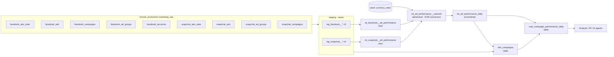

# Marketing Data Platform: Databricks + dbt

A small but production-minded data platform that unifies **Facebook Ads** and
**Snapchat Ads** performance into one tested, documented, governed dataset for
analysts, BI tools and AI agents.

> **Start here as a consumer:** `mart_campaign_performance_daily`, one row per campaign,
> per platform, per day, with spend in EUR, impressions, clicks, CTR, CPC and CPM.

---

## 1. Problem → solution

| Problem (from the brief) | How this project solves it |
|---|---|
| Marketers log into each platform and merge data in Excel | One pipeline lands both platforms in one table |
| Facebook and Snapchat name and structure data differently | Staging + intermediate models translate both into one shape |
| Data only accessible to Marketing | Unity Catalog grants give any team read access to `marts` |
| Poor reusability | Layered models: reuse the fact, the dimension or the mart |
| No documentation, lineage, quality monitoring | dbt docs + lineage, 89 tests, Elementary observability |

---

## 2. The source data (what profiling found)

| Platform | Tables | Stats grain | Period | Currency |
|---|---|---|---|---|
| Facebook | stats, ads, ad sets, campaigns, accounts | ad × day | 2025-01-01 → 2025-12-31 | EUR **and USD** (by account) |
| Snapchat | stats, ads, ad squads (history), campaigns | ad × day × **country** | 2024-01-01 → 2024-12-02 (no Apr/May/Oct) | EUR |

Findings that shaped the design:

1. **Stats tables hold only IDs and numbers.** Names come from 3–4 other tables, so joins are part of the model.
2. **Different grains.** Snapchat splits each ad-day by country (DE/CH/AT); Facebook doesn't.
3. **Mixed currencies.** Two of the three Facebook accounts with spend bill in USD. Summing raw spend
   would overstate total spend by about €790k (≈9%). Everything is converted to EUR.
4. **Missing values are the text `"null"`.** Facebook: 24k null clicks vs only 42 explicit zeros, and the
   null rows are tiny (median 24 impressions vs 2,661). Facebook omits zero metrics, so null → 0, with a flag.
5. **History duplicates.** Three Snapchat ad groups appear twice; the latest version wins.
6. **Orphans.** 12% of Snapchat ads point to an ad group missing from the export; none has delivery
   (tested as a *warning*).
7. **The periods don't overlap.** Facebook is 2025, Snapchat is 2024, so platform comparisons are across years.

---

## 3. Architecture



| Layer | Where (dev / prod) | Responsibility |
|---|---|---|
| Raw / Bronze | `third_layer.marketing_staging` (yours) or `bronze_production.marketing_raw` | Exact copy of the 9 files, all STRING, plus `_source_file`, `_loaded_at` |
| Staging | `…marketing_staging` / `marketing_production.staging` | One model per source table: rename, type, clean `"null"`, deduplicate |
| Intermediate | `…marketing_intermediate` | Join each platform's hierarchy; stack platforms; convert to EUR |
| Marts | `…marketing_marts` / `marketing_production.marts` | Fact, dimension and wide KPI table |
| Consumption | SQL, BI, AI agents | Read only from `marts` |

---

## 4. Repository layout

```
cdc_marketing/
├── databricks/
│   ├── 00_setup_catalogs.sql          catalogs, raw schema, landing volume
│   ├── 01_load_raw_ads.sql            idempotent COPY INTO for the 9 files
│   └── 02_unity_catalog_grants.sql    least-privilege grants
├── seeds/currency_rates.csv           EUR exchange rates (edit to refine)
├── models/
│   ├── staging/facebook/              5 sources + 5 stg models
│   ├── staging/snapchat/              4 sources + 4 stg models
│   ├── intermediate/                  per-platform joins + union/EUR
│   └── marts/marketing/               fct, dim, mart + docs
├── macros/       clean_string, safe_divide, generate_schema_name, drop_ci_schemas
├── tests/        singular tests (reconciliation, clicks ≤ impressions)
├── analyses/     SQL answering the brief's business questions
├── .github/workflows/   ci.yml, ci_teardown.yml, deploy_prod.yml
└── docs/WALKTHROUGH.md  step-by-step learning guide
```

---

## 5. Setup

### 5.1 Databricks (once)
1. Run `databricks/00_setup_catalogs.sql`.
2. Upload each CSV to its folder in `/Volumes/bronze_production/marketing_raw/landing/` (table in `01_load_raw_ads.sql`).
3. Run `databricks/01_load_raw_ads.sql`; compare the row counts with the expected ones in the script.
4. Create a Service Principal, generate an OAuth secret, give it *Can use* on the SQL warehouse.
5. Put its Application ID into `databricks/02_unity_catalog_grants.sql` and run it.

### Which raw table is which? (run once in the Databricks SQL editor)

The raw tables are numbered (`facebook_1` … `snapchat_4`), so check which file each one holds.
Look for the column that gives it away (`ad_spend` + `ad_date` = stats, `ad_currency_code` +
`account_name` = accounts, and so on), then fix the `identifier:` lines in
`models/staging/*/_*__sources.yml` if they differ.

```sql
select table_name,
       array_join(collect_list(column_name), ', ') as columns
from third_layer.information_schema.columns
where table_schema = 'marketing_staging'
  and (table_name like 'facebook%' or table_name like 'snapchat%')
group by table_name
order by table_name;
```

| Source in dbt | Expected columns | Assumed table |
|---|---|---|
| facebook_ads_stats | ad_id, account_id, ad_spend, ad_impressions, ad_clicks, ad_date | facebook_1 |
| facebook_accounts | account_id, account_name, ad_currency_code, … | facebook_2 |
| facebook_ad_groups | ad_group_id, ad_group_name, ad_group_updated_at | facebook_3 |
| facebook_ads | ad_id, campaign_id, ad_group_id, account_id, ad_name, ad_status, … | facebook_4 |
| facebook_campaigns | campaign_id, campaign_name, campaign_updated_at | facebook_5 |
| snapchat_ads | ad_id, ad_group_id, ad_name, ad_detail_updated_at | snapchat_1 |
| snapchat_ad_groups | _surrogate_key, ad_group_id, campaign_id, ad_group_name, … | snapchat_2 |
| snapchat_campaigns | campaign_id, account_id, campaign_name | snapchat_3 |
| snapchat_ads_stats | ad_detail_id, ad_currency_code, ad_country, ad_spend, … | snapchat_4 |

### 5.2 Local development (uv)
```bash
uv add dbt-databricks "elementary-data[databricks]"   # once
cp .env.example .env        # host, http path, token (from your current profiles.yml)
set -a; source .env; set +a

uv run dbt deps             # install dbt_utils + elementary
uv run dbt debug            # connection check (target dev → catalog third_layer)
uv run dbt build            # seed + models + tests, in dependency order
uv run dbt docs generate --static     # single-file docs: target/static_index.html
uv run edr report --profile-target dev
```

### 5.3 GitHub
Create Environments (Settings → Environments) with these secrets:

| Environment | Secret | Value |
|---|---|---|
| `ci` | `DATABRICKS_HOST`, `DATABRICKS_HTTP_PATH`, `DATABRICKS_CI_TOKEN` | workspace, warehouse, CI token |
| `production` | `DATABRICKS_HOST`, `DATABRICKS_HTTP_PATH` | workspace, warehouse |
| `production` | `DATABRICKS_SP_CLIENT_ID`, `DATABRICKS_SP_CLIENT_SECRET` | Service Principal OAuth |

Protect `main`: require a pull request and the **dbt-ci** check. Enable Pages (Source: GitHub Actions).

---

## 6. Engineering decisions

### 6.1 Grain and keys

| Model | One row = | Primary key |
|---|---|---|
| `stg_facebook__ad_stats` | Facebook ad × day | ad_id + date_day |
| `stg_snapchat__ad_stats` | Snapchat ad × day × country | ad_id + date_day + country_code |
| other `stg_*` | one ad / ad group / campaign / account | its id |
| `fct_ad_performance_daily` | ad × platform × day × country (NULL for Facebook) | `ad_performance_id` = hash(platform, ad_id, date_day, country_code) |
| `dim_campaigns` | campaign × platform | `campaign_key` = hash(platform, campaign_id) |
| `mart_campaign_performance_daily` | campaign × platform × day | `campaign_day_id` = hash(campaign_key, date_day) |

* The fact keeps the **finest grain available** so nothing is lost: Snapchat's country split survives.
* Keys always include `platform`, because IDs are only unique within a platform.

### 6.2 Model structure
* **One staging model per source table:** single responsibility, and each is testable on its own.
* **One intermediate model per platform** joins that platform's hierarchy and outputs a *shared column contract*.
  Facebook ads point directly at campaigns; Snapchat goes ad → ad group → campaign. That difference stays inside one file.
* **Fact** holds only *additive* measures; **dimension** lists every campaign (including ones that never spent);
  **wide mart** pre-joins both with KPIs for humans and AI agents.

### 6.3 Platform normalization

| Concept | Facebook | Snapchat | Unified |
|---|---|---|---|
| Ad key in stats | `ad_id` | `ad_detail_id` | `ad_id` |
| Middle level | ad set | ad squad | `ad_group_*` |
| Country | not provided | `ad_country` (lower) | `country_code` (upper, NULL for FB) |
| Currency | from account table | on each stats row | `currency_code` + `spend_eur` |
| Account | account table | id on campaign only | `account_id`, `account_name` |
| Missing metric | text `"null"` | text `"null"` | 0 + `is_*_missing` flag |

### 6.4 Currency
`seeds/currency_rates.csv` holds a rate per currency and validity period; spend converts with the rate valid on the
reporting day. The USD rates are **approximate yearly averages**. Swap in daily ECB rates for finance-grade accuracy (same columns).

### 6.5 Materializations

| Model | Materialization | Why |
|---|---|---|
| staging | **view** | Light logic, small data, always in sync with raw |
| per-platform intermediate | **view** | Queryable while debugging joins; cheap |
| `int_ad_performance__unioned` | **ephemeral** | Plumbing only; inlined as a CTE into the fact |
| `fct_ad_performance_daily` | **incremental (merge)** | Grows forever; re-processes last *N* days + newly loaded rows, MERGE on key; liquid-clustered on date, platform |
| `dim_campaigns` | **table** | Small, joined constantly, full rebuild keeps names current |
| `mart_campaign_performance_daily` | **table** | Most-queried object: compute once per run |
| `currency_rates` | **seed** | Human-maintained reference data, versioned in Git |

### 6.6 Data quality (89 tests)

| Test | Protects against |
|---|---|
| `unique` / `not_null` / `unique_combination_of_columns` on every key | Duplicates inflating spend; broken grain |
| `relationships` along both hierarchies | Stats that can't be attributed to a campaign |
| `relationships` Snapchat ad → ad group (**warn**) | Known 12% orphans, visible but not blocking |
| `accepted_values` platform, currency, ad status | Typos and unexpected categories |
| `expression_is_true >= 0` on spend, impressions, clicks | Corrupted metrics |
| `not_null` on `rate_to_eur` / `spend_eur` | A currency without an exchange rate |
| `accepted_range` CTR 0–1 (warn) | Swapped columns |
| singular: clicks ≤ impressions (warn) | Physically impossible data |
| singular: spend reconciles staging → fact → mart, per platform and currency | Joins losing or duplicating money |
| source freshness, Elementary schema changes, volume & spend anomalies | Silent pipeline failures and drift |

### 6.7 Environments

| | Dev | CI | Prod |
|---|---|---|---|
| Who | developer (personal token) | GitHub Actions (CI token) | GitHub Actions (**Service Principal, OAuth**) |
| Target | `dev` | `ci` | `prod` |
| Catalog | `third_layer` | `ci_development` | `marketing_production` |
| Schemas | `marketing_staging`, `marketing_marts`… | `ci_pr_<N>_staging`… (dropped on PR close) | `staging`, `marts`, `elementary` |

### 6.8 Security
* Production authenticates with a **Service Principal (OAuth M2M)**, never a personal token.
* No secrets in Git: `profiles.yml` reads environment variables only.
* Least privilege: SP reads bronze and writes only `marketing_production`; analysts get `SELECT` on `marts`.
* `persist_docs` writes mart descriptions into Unity Catalog.

### 6.9 CI/CD
```
branch → PR → dbt-ci (parse, build --full-refresh, tests, docs, Elementary) → green + review → merge
       → dbt-deploy-prod as Service Principal → static docs to GitHub Pages
```

---

## 7. Results (first build)

| | Facebook (2025) | Snapchat (2024) | Total |
|---|---|---|---|
| Spend (EUR) | €8,642,101 | €30,530 | €8,672,631 |
| Impressions | 905.4 M | 33.4 M | 938.8 M |
| Clicks | 5.74 M | 19.0 k | 5.76 M |
| CTR | 0.63 % | 0.06 % | |
| CPC | €1.51 | €1.61 | |
| CPM | €9.54 | €0.91 | |
| Campaigns with delivery | 77 | 9 | 86 |

More queries: `analyses/business_questions.sql`.

---

## 8. Next steps
Daily ECB rates · ingestion straight from the ad APIs · slim CI (`state:modified+`, `--defer`) ·
metric views / semantic layer for agents · Elementary alerts to Slack/Teams · a country dimension.
